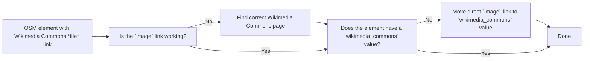

# openstreetmap-wikimedia-thumbnail-correction-helper

Discussion: [OSM Community Forum, thread 148079](https://c.osm.org/t/148079)

An OpenStreetMap bot that fixes **broken** Wikimedia Commons thumbnail links in
`image=*`:

```
image=https://upload.wikimedia.org/wikipedia/commons/thumb/e/e9/Strassenschild_Kirchbergerstrasse.jpg/800px-Strassenschild_Kirchbergerstrasse.jpg
```

- If the element has no
  [`wikimedia_commons=*`](https://wiki.openstreetmap.org/wiki/Key:wikimedia_commons),
  the link is moved there (as the file title, with spaces like the OSM wiki examples)
  and `image=*` is removed:
  ```
  wikimedia_commons=File:Strassenschild Kirchbergerstrasse.jpg
  ```
- If `wikimedia_commons=*` already names the same file, `image=*` is redundant and is
  removed.
- If `wikimedia_commons=*` names something else (usually a `Category:`), `image=*` is
  replaced with the file's description page on Commons:
  ```
  image=https://commons.wikimedia.org/wiki/File:Strassenschild_Kirchbergerstrasse.jpg
  ```

Elements whose thumbnail still works are not touched, so no element version is
increased without need.

## Background

This bot started in the [OSM Community Forum](https://c.osm.org/t/148079): habi
noticed broken Wikimedia Commons thumbnail links in OSM and joked that a simple
`s/800px/960px/g` over the OSM database would solve the problem. That would only
have swapped one hotlinked thumbnail for another, and broken links in other widths
or on images narrower than 960 px. This bot solves it properly: it only touches
links that are really broken, and points them to the file's description page,
where the author and license are given.

## Why

Wikimedia now only serves hotlinked thumbnails in the
[standard widths](https://www.mediawiki.org/wiki/Common_thumbnail_sizes)
(20, 40, 60, 120, 250, 330, 500, 960, 1280, 1920, 3840 px,
[T414805](https://phabricator.wikimedia.org/T414805)). Everything else returns
HTTP 400, so thousands of `image=*` tags are dead links. The description page
always works, and it shows the author and license, which a bare thumbnail does not.

## Workflow



## What it touches

Only `image=*` values that are **exactly one** URL of the form
`https://upload.wikimedia.org/wikipedia/commons/thumb/<h>/<hh>/<File>/<…><width>px-<…>`, where

- the `<h>/<hh>` directory matches the MD5 of the decoded file name (so the name was parsed correctly),
- the file still exists on Commons (renamed files are followed to their current name),
- the thumbnail is broken: its width is not a standard width, or it is wider than
  the original bitmap.

It leaves alone working thumbnails, original-file links (`/commons/<h>/<hh>/…`),
other wikis (`/wikipedia/de/…`), multiple values (`;`), other keys (`image:*`, …)
and anything it can't parse. An existing `wikimedia_commons=*` is never changed;
the key is only added when it is missing or empty.

### SVG thumbnails (logos)

Thumbnails of SVG files are often logos, e.g.
`image=…/Aral_Logo.svg/220px-Aral_Logo.svg.png` on an Aral fuel station
([#1](https://github.com/habi/openstreetmap-wikimedia-thumbnail-correction-helper/issues/1)).
For now these are **not edited**, only flagged in the log (and as a warning on the
run). Each flagged element shows whether the file name says "logo" and whether the
element is in the [Name Suggestion Index](https://github.com/osmlab/name-suggestion-index)
(NSI): by its `brand:wikidata`, `operator:wikidata`, … or, without those, by `brand=*`
within the matching NSI category (e.g. `amenity=fuel`). The NSI data is loaded once
per run, from the jsDelivr CDN, and only if there are SVG thumbnails.

Commons itself has no "is a logo" flag. Hints are the file type (SVG), categories
such as *SVG logos of Aral AG*, the restriction *trademarked*, or the structured-data
statement *depicts: logo*.

## Keeping load low

- **Overpass**: one query per run, limited to a country (`AREA`, default `CH`),
  `out tags center;` only (tags plus one point per element, no full geometry).
  Retries with backoff on 429/5xx. Runs weekly.
- **Wikimedia**: whether a thumbnail works comes from its width, so no thumbnail is
  ever downloaded. The Action API is queried 50 files per request, one request at a
  time with a 1 s pause, `maxlag=5`, and a descriptive User-Agent, and only for
  the files of the group edited in this run (see below).
- **OSM API**: multi-fetch (`/nodes?nodes=…`) of only the elements that will be
  edited, one changeset per run, at most `MAX_EDITS` (default 200) edits.

## Small changesets

Each run's edits are picked to lie as close together as possible, so every
changeset covers a small area and is easy to review (e.g. 200 edits within
1.5 km × 1.3 km in Bern, instead of spread over all of Switzerland). The width in
the URL already shows which thumbnails are broken, so the grouping happens before
any request to Commons: the broken links are ordered along a
[Hilbert curve](https://en.wikipedia.org/wiki/Hilbert_curve), and of all runs of
`MAX_EDITS` consecutive links, the one with the smallest bounding box is taken
(or the nearest neighbours of its center, if those are closer together).
Thumbnails in standard widths are only checked inside that box. The next run
takes the next group. The log and the run summary show the area, with a map link.

## Running locally

```sh
pip install -r requirements.txt
python bot.py --area CH --max-edits 50 --report report.json   # dry run
OSM_ACCESS_TOKEN=… python bot.py --area CH --apply           # upload
pytest -q
```

## GitHub Action

`.github/workflows/fix-commons-thumbnails.yml` runs the tests and then the bot every
Monday, and can also be started manually (*Actions → Run workflow*).

Every run can be checked afterwards:

- **Log** of the *Run bot* step: every element looked at, grouped (collapsible) into
  *would edit* / *edited in changeset N* (with old → new value), *left alone,
  thumbnail still works*, *skipped, file not on Commons*, *skipped, changed in
  OSM meanwhile* and *not edited, SVG thumbnail, possibly a logo* (with NSI match),
  each with a link to the element, followed by a one-line summary.
- **Summary page** of the run: counts, the changeset link, and a table of all
  edits with links to the element, the broken thumbnail and the new Commons page.
- **Artifact** `report.json`: the edits as machine-readable JSON.

Setup:

1. Create a dedicated OSM bot account (e.g. `yourname_bot`). Logged in as that
   account, register an
   [OAuth 2 application](https://www.openstreetmap.org/oauth2/applications/new)
   with redirect URI `urn:ietf:wg:oauth:2.0:oob` and the permission *Modify the
   map* (nothing else is needed). Then exchange its client ID and secret for an
   **access token** and store that as the repository secret **`OSM_ACCESS_TOKEN`**
   (the client secret itself does not work):
   ```sh
   python get_token.py | gh secret set OSM_ACCESS_TOKEN
   ```
   The script asks for the client ID and secret, prints a link to open while logged
   in as the bot account, and takes the code shown after *Authorize*. The token
   does not expire. Upload runs check the token before doing anything else.
2. Optional repository variables: `AREA` (ISO 3166-1 code or `world`), `MAX_EDITS`,
   `CHANGESET_DESCRIPTION_URL` (link to the bot's OSM wiki page, added to each
   changeset).
3. Scheduled runs are **dry runs** until you set the repository variable
   **`BOT_ENABLED=true`**. Manual runs upload only if *apply* is ticked.

> ⚠️ Before enabling uploads, follow the OSM
> [Automated Edits code of conduct](https://wiki.openstreetmap.org/wiki/Automated_Edits_code_of_conduct):
> document the bot on the OSM wiki, discuss it with the affected community (e.g. the
> Swiss community on community.openstreetmap.org), and use a separate bot account.
